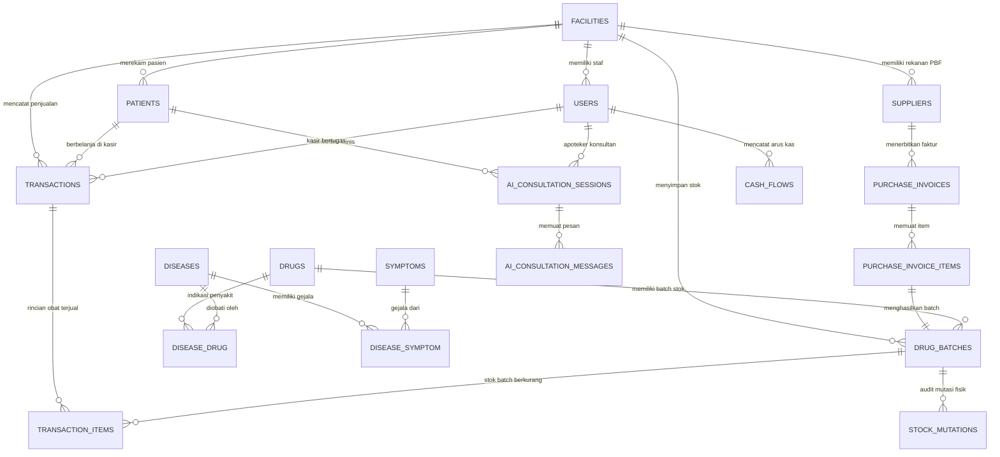

# 📘 MediagnoTek Database Architecture & Data Dictionary
> **Target Engine**: PostgreSQL (SQLAlchemy 2.0 Async / asyncpg / psycopg)  
> **Schema Location**: `mediagnotek-backend/app/db/schema.sql`  
> **Python Models**: `mediagnotek-backend/app/models/`  
> **Audience**: AI Agents, Backend Engineers, and Apothecary System Auditors

---

## 1. Arsitektur & Filosofi Desain

Database MediagnoTek dirancang dengan 4 prinsip farmasi klinis dan finansial utama:

1. **Multi-Tenant Faskes (`facilities`)**:  
   Setiap data transaksi, inventori, faktur, dan buku pasien diisolasi berdasarkan `facility_id`. Satu deployment server dapat melayani multi-apotek atau multi-klinik secara aman.
2. **Mesin FEFO (First Expired, First Out) Mandatori**:  
   Katalog obat (`drugs`) dipisah secara ketat dari stok fisik (`drug_batches`). Setiap obat memiliki banyak batch dengan tanggal kedaluwarsa (`expired_date`) dan harga beli modal (`harga_beli_hpp`) yang berbeda. Pengeluaran obat di kasir selalu mengutamakan batch dengan `expired_date` terdekat.
3. **Financial Snapshotting (Integritas Laporan Masa Lalu)**:  
   Pada saat transaksi kasir terjadi, `harga_jual_satuan` dan `hpp_satuan` dari batch disalin secara permanen ke `transaction_items`. Kenaikan harga modal obat di masa depan tidak akan pernah merusak atau mengubah angka laba kotor di masa lampau.
4. **Buku Besar Mutasi Stok Ganda (Double-Entry Inventory Ledger)**:  
   Setiap perubahan stok (penjualan kasir, faktur PBF, opname, retur, expired) wajib dicatat dalam `stock_mutations` dengan mencatat `stok_sebelum` dan `stok_sesudah` beserta nomor referensi bukti fisik.

---

## 2. Diagram Relasi Entitas (ERD)



---

## 3. Kamus Data (Data Dictionary)

### Domain A: Organisasi & Keamanan (Fasilitas & RBAC)

#### Tabel: `facilities`
Menyimpan profil legalitas apotek dan faskes untuk penerbitan struk dan kop resep.
| Kolom | Tipe Data | Constraint | Deskripsi |
| :--- | :--- | :--- | :--- |
| `id` | `SERIAL` | `PRIMARY KEY` | ID Faskes |
| `nama` | `VARCHAR(255)` | `NOT NULL` | Nama Apotek / Faskes |
| `kode_faskes` | `VARCHAR(50)` | `UNIQUE` | Kode unik fasilitas (opsional) |
| `alamat` | `TEXT` | `NOT NULL` | Alamat fisik faskes |
| `no_telp` | `VARCHAR(50)` | | Nomor telepon apotek |
| `email` | `VARCHAR(100)` | | Email resmi |
| `nomor_sia` | `VARCHAR(100)` | | Surat Izin Apotek |
| `nomor_sipa` | `VARCHAR(100)` | | SIPA Apoteker Pengelola (APA) |
| `nama_apa` | `VARCHAR(200)` | | Nama Apoteker Pengelola Apotek |
| `logo_url` | `TEXT` | | URL / path logo apotek |
| `created_at` | `TIMESTAMP` | `DEFAULT now()` | Waktu pendaftaran |

#### Tabel: `users`
Akun staf farmasi dengan Role-Based Access Control (RBAC).
| Kolom | Tipe Data | Constraint | Deskripsi |
| :--- | :--- | :--- | :--- |
| `id` | `SERIAL` | `PRIMARY KEY` | ID Pengguna |
| `facility_id` | `INT` | `FK -> facilities(id)` | Faskes tempat bekerja |
| `username` | `VARCHAR(100)` | `NOT NULL, UNIQUE` | Username login |
| `email` | `VARCHAR(150)` | `NOT NULL, UNIQUE` | Email staf |
| `password_hash`| `VARCHAR(255)` | `NOT NULL` | Hash password (bcrypt/argon2) |
| `nama_lengkap` | `VARCHAR(200)` | `NOT NULL` | Nama lengkap staf |
| `role` | `VARCHAR(50)` | `CHECK IN ('ADMIN', 'APOTEKER', 'KASIR', 'KEUANGAN')` | Peran wewenang |
| `is_active` | `BOOLEAN` | `DEFAULT true` | Status keaktifan akun |

---

### Domain B: Logistik, PBF, dan Mesin Stok FEFO

#### Tabel: `suppliers`
Pedagang Besar Farmasi (PBF) tempat apotek memasok obat.
| Kolom | Tipe Data | Constraint | Deskripsi |
| :--- | :--- | :--- | :--- |
| `id` | `SERIAL` | `PRIMARY KEY` | ID Distributor |
| `facility_id` | `INT` | `FK -> facilities(id)` | Kepemilikan faskes |
| `nama_pbf` | `VARCHAR(255)` | `NOT NULL` | Nama distributor resmi |
| `no_izin_pbf` | `VARCHAR(100)` | | Nomor Izin PBF dari Kemenkes |
| `nama_kontak` | `VARCHAR(150)` | | Salesman / PIC |
| `no_telp` | `VARCHAR(50)` | | Nomor kontak telepon / WA |
| `nomor_rekening`| `VARCHAR(100)`| | Rekening transfer faktur |

#### Tabel: `drugs` (Master Data Obat)
Katalog farmasi medis dan informasi regulasi.
| Kolom | Tipe Data | Constraint | Deskripsi |
| :--- | :--- | :--- | :--- |
| `id` | `SERIAL` | `PRIMARY KEY` | ID Obat |
| `nama` | `VARCHAR(500)` | `NOT NULL, INDEX` | Nama generik / dagang |
| `barcode` | `VARCHAR(100)` | `UNIQUE, INDEX` | Kode barcode botol / box |
| `satuan_terkecil`| `VARCHAR(50)`| `DEFAULT 'Tablet'`| Satuan jual: Strip, Botol, Tablet |
| `golongan` | `VARCHAR(50)` | `DEFAULT 'Bebas'` | Bebas, Terbatas, Keras, Narkotika |
| `stok_minimum` | `INT` | `DEFAULT 10` | Ambang batas peringatan restock |
| `harga_jual_default`| `NUMERIC(12,2)`| `DEFAULT 0` | Harga jual standar |
| `rxcui` | `VARCHAR(50)` | | Mapping RxNav untuk interaksi |
| `is_active` | `BOOLEAN` | `DEFAULT true` | Status obat masih dijual atau tidak |

#### Tabel: `drug_batches` (Inventori Fisik & Modal HPP)
Jantung operasional FEFO dan kalkulasi modal apotek.
| Kolom | Tipe Data | Constraint | Deskripsi |
| :--- | :--- | :--- | :--- |
| `id` | `SERIAL` | `PRIMARY KEY` | ID Batch Fisik |
| `facility_id` | `INT` | `FK -> facilities(id)` | Faskes pemilik stok |
| `drug_id` | `INT` | `FK -> drugs(id)` | Master obat |
| `supplier_id` | `INT` | `FK -> suppliers(id)` | PBF asal barang |
| `batch_number`| `VARCHAR(100)` | `NOT NULL` | No batch dari pabrikan |
| `expired_date`| `DATE` | `NOT NULL, INDEX` | Tanggal kedaluwarsa fisik (FEFO) |
| `stok_awal` | `INT` | `CHECK >= 0` | Jumlah stok saat faktur diterima |
| `stok_sisa` | `INT` | `CHECK >= 0` | Sisa stok fisik yang belum terjual |
| `harga_beli_hpp`| `NUMERIC(12,2)`| `NOT NULL` | HPP Modal Bersih per satuan |
| `harga_jual` | `NUMERIC(12,2)` | `NOT NULL` | Harga jual ke konsumen |
| `is_active` | `BOOLEAN` | `DEFAULT true` | Aktif / Dinonaktifkan |

---

### Domain C: Pasien & Rekam Medis Farmasi

#### Tabel: `patients`
| Kolom | Tipe Data | Constraint | Deskripsi |
| :--- | :--- | :--- | :--- |
| `id` | `SERIAL` | `PRIMARY KEY` | ID Pasien |
| `facility_id` | `INT` | `FK -> facilities(id)` | Faskes yang mendaftar |
| `nomor_rm` | `VARCHAR(50)` | `NOT NULL, INDEX` | Nomor Rekam Medis Farmasi |
| `nama_lengkap` | `VARCHAR(200)`| `NOT NULL, INDEX` | Nama lengkap pasien |
| `nik` | `VARCHAR(20)` | | NIK KTP (opsional) |
| `tanggal_lahir`| `DATE` | | Tanggal lahir (hitung usia) |
| `jenis_kelamin`| `VARCHAR(10)` | `CHECK ('L', 'P')` | Gender |
| `no_hp` | `VARCHAR(30)` | `NOT NULL, INDEX` | Nomor HP/WhatsApp aktif |
| `riwayat_alergi`| `TEXT` | | Catatan zat aktif pemicu alergi |
| `riwayat_komorbid`| `TEXT` | | Riwayat penyakit penyerta |

---

### Domain D: Kasir POS & Transaksi Penjualan

#### Tabel: `transactions`
| Kolom | Tipe Data | Constraint | Deskripsi |
| :--- | :--- | :--- | :--- |
| `id` | `SERIAL` | `PRIMARY KEY` | ID Transaksi |
| `facility_id` | `INT` | `FK -> facilities(id)` | Faskes penerbit transaksi |
| `nomor_struk` | `VARCHAR(100)`| `NOT NULL, UNIQUE`| Nomor struk cetak (TRX-...) |
| `user_id` | `INT` | `FK -> users(id)` | Kasir yang bertugas |
| `patient_id` | `INT` | `FK -> patients(id)` | Pasien (bisa NULL untuk walk-in) |
| `tanggal_transaksi`| `TIMESTAMP`| `DEFAULT now()` | Waktu bayar di kasir |
| `jenis_transaksi`| `VARCHAR(50)`| `CHECK ('BEBAS', 'RESEP_PATEN', 'RESEP_RACIKAN')` | Jenis pelayanan |
| `total_omzet` | `NUMERIC(14,2)`| `NOT NULL` | Uang masuk bruto |
| `total_hpp` | `NUMERIC(14,2)`| `NOT NULL` | Total modal obat terjual |
| `laba_kotor` | `NUMERIC(14,2)`| `NOT NULL` | `total_omzet - total_hpp` |
| `margin_persen`| `NUMERIC(6,2)` | `NOT NULL` | `(laba_kotor / total_omzet) * 100` |
| `metode_bayar`| `VARCHAR(50)`| `CHECK ('TUNAI', 'QRIS', 'DEBIT', 'TRANSFER')` | Cara bayar |
| `nominal_tunai`| `NUMERIC(14,2)`| | Uang tunai diterima |
| `nominal_kembalian`| `NUMERIC(14,2)`| | Uang kembalian ke pasien |

#### Tabel: `transaction_items`
| Kolom | Tipe Data | Constraint | Deskripsi |
| :--- | :--- | :--- | :--- |
| `id` | `SERIAL` | `PRIMARY KEY` | ID Item Penjualan |
| `transaction_id`| `INT` | `FK -> transactions(id) ON DELETE CASCADE` | Induk transaksi |
| `drug_id` | `INT` | `FK -> drugs(id)` | Master obat |
| `batch_id` | `INT` | `FK -> drug_batches(id)` | Batch fisik yang terpotong |
| `jumlah` | `INT` | `CHECK > 0` | Kuantitas obat dibeli |
| `harga_jual_satuan`| `NUMERIC(12,2)`| `NOT NULL` | **Snapshot** harga jual saat transaksi |
| `hpp_satuan` | `NUMERIC(12,2)`| `NOT NULL` | **Snapshot** HPP modal batch saat transaksi |
| `subtotal_omzet`| `NUMERIC(14,2)`| `NOT NULL` | `jumlah * harga_jual_satuan` |
| `subtotal_hpp` | `NUMERIC(14,2)`| `NOT NULL` | `jumlah * hpp_satuan` |
| `laba_item` | `NUMERIC(14,2)`| `NOT NULL` | `subtotal_omzet - subtotal_hpp` |
| `aturan_pakai`| `VARCHAR(200)`| | Signa pemakaian (contoh: 3x1 sesudah makan) |

---

### Domain E: Audit Stok & Pembukuan Keuangan

#### Tabel: `stock_mutations`
Catatan mutasi fisik barang (audit trail farmasi).
| Kolom | Tipe Data | Constraint | Deskripsi |
| :--- | :--- | :--- | :--- |
| `id` | `SERIAL` | `PRIMARY KEY` | ID Log Mutasi |
| `facility_id` | `INT` | `FK -> facilities(id)` | Faskes |
| `drug_id` | `INT` | `FK -> drugs(id)` | Master obat |
| `batch_id` | `INT` | `FK -> drug_batches(id)` | Batch yang bergerak |
| `tipe_mutasi` | `VARCHAR(50)` | `CHECK IN ('MASUK_FAKTUR', 'KELUAR_PENJUALAN', 'PENYESUAIAN_OPNAME', 'RETUR_PBF', 'RUSAK_KEDALUWARSA')` | Jenis mutasi |
| `jumlah` | `INT` | `NOT NULL` | Nilai perubahan (+ masuk, - keluar) |
| `stok_sebelum` | `INT` | `NOT NULL` | Saldo sebelum mutasi |
| `stok_sesudah` | `INT` | `NOT NULL` | Saldo setelah mutasi |
| `referensi_id` | `VARCHAR(100)`| | No Struk / No Faktur PBF |
| `keterangan` | `TEXT` | | Alasan / catatan audit |

#### Tabel: `cash_flows`
Buku kas umum apotek (penerimaan kasir vs pengeluaran operasional).
| Kolom | Tipe Data | Constraint | Deskripsi |
| :--- | :--- | :--- | :--- |
| `id` | `SERIAL` | `PRIMARY KEY` | ID Buku Kas |
| `facility_id` | `INT` | `FK -> facilities(id)` | Faskes |
| `user_id` | `INT` | `FK -> users(id)` | Staf pencatat |
| `tanggal` | `DATE` | `NOT NULL, INDEX` | Tanggal transaksi kas |
| `tipe` | `VARCHAR(20)` | `CHECK ('MASUK', 'KELUAR')` | Debit / Kredit kas |
| `kategori` | `VARCHAR(100)`| `NOT NULL` | `PENJUALAN_KASIR`, `BAYAR_PBF`, `OPERASIONAL`, dll |
| `nominal` | `NUMERIC(14,2)`| `NOT NULL` | Jumlah rupiah |
| `deskripsi` | `TEXT` | | Uraian transaksi |

---

### Domain F: Sesi Chat AI Klinis & Telaah Resep

#### Tabel: `ai_consultation_sessions`
| Kolom | Tipe Data | Constraint | Deskripsi |
| :--- | :--- | :--- | :--- |
| `id` | `VARCHAR(100)`| `PRIMARY KEY` | UUID Sesi Chat |
| `facility_id` | `INT` | `FK -> facilities(id)` | Faskes |
| `user_id` | `INT` | `FK -> users(id)` | Apoteker yang berdiskusi |
| `patient_id` | `INT` | `FK -> patients(id)` | Pasien yang ditelaah (opsional) |
| `judul_konsultasi`| `VARCHAR(255)`| | Judul topik kasus |
| `mode_tampilan`| `VARCHAR(50)`| `DEFAULT 'STANDARD'` | `STANDARD` atau `ROOM_CHAT_FULLSCREEN` |

#### Tabel: `ai_consultation_messages`
| Kolom | Tipe Data | Constraint | Deskripsi |
| :--- | :--- | :--- | :--- |
| `id` | `SERIAL` | `PRIMARY KEY` | ID Pesan |
| `session_id` | `VARCHAR(100)`| `FK -> ai_consultation_sessions(id)` | Induk sesi chat |
| `sender` | `VARCHAR(20)` | `CHECK ('USER', 'AI', 'SYSTEM')` | Pengirim bubble chat |
| `content` | `TEXT` | `NOT NULL` | Isi teks percakapan |
| `lampiran_resep_url`| `TEXT` | | Berkas foto resep yang diunggah |
| `detected_icd10_code`| `VARCHAR(20)`| | Kode ICD-10 yang terdeteksi AI (misal: "I10") |
| `detected_icd10_desc`| `VARCHAR(255)`| | Deskripsi diagnosa medis |
| `interaksi_ditemukan`| `JSONB` | | Array JSON interaksi obat berbahaya |

---

## 4. Query Utama & Logika Bisnis Farmasi (Contoh Nyata)

### A. Algoritma Pemilihan Batch FEFO di Kasir
```sql
-- Dijalankan saat kasir memilih obat untuk dijual:
-- Mengambil batch terdekat dari expired yang stoknya masih ada
SELECT 
    id AS batch_id,
    batch_number,
    expired_date,
    stok_sisa,
    harga_beli_hpp,
    harga_jual
FROM drug_batches
WHERE drug_id = :selected_drug_id
  AND facility_id = :current_facility_id
  AND is_active = TRUE
  AND stok_sisa > 0
ORDER BY expired_date ASC, id ASC;
```

### B. Query Rekap Keuangan & Margin Harian (Sinkron dengan `/dashboard/keuangan`)
```sql
SELECT 
    DATE(tanggal_transaksi) AS tanggal,
    COUNT(id) AS jumlah_transaksi,
    SUM(total_omzet) AS total_omzet,
    SUM(total_hpp) AS total_modal_hpp,
    SUM(laba_kotor) AS total_laba_kotor,
    ROUND((SUM(laba_kotor) / NULLIF(SUM(total_omzet), 0)) * 100, 2) AS rata_rata_margin_persen
FROM transactions
WHERE facility_id = :facility_id
  AND tanggal_transaksi >= :start_date 
  AND tanggal_transaksi <= :end_date
GROUP BY DATE(tanggal_transaksi)
ORDER BY tanggal DESC;
```

### C. Deteksi Obat Krisis Kedaluwarsa (<90 Hari & <30 Hari)
```sql
SELECT 
    d.nama AS nama_obat,
    b.batch_number,
    b.expired_date,
    b.stok_sisa,
    (b.expired_date - CURRENT_DATE) AS sisa_hari,
    CASE 
        WHEN b.expired_date <= CURRENT_DATE THEN 'KEDALUWARSA'
        WHEN b.expired_date <= CURRENT_DATE + INTERVAL '30 days' THEN 'KRITIS_30_HARI'
        ELSE 'WASPADA_90_HARI'
    END AS status_urgensi
FROM drug_batches b
JOIN drugs d ON d.id = b.drug_id
WHERE b.facility_id = :facility_id
  AND b.stok_sisa > 0
  AND b.expired_date <= CURRENT_DATE + INTERVAL '90 days'
ORDER BY b.expired_date ASC;
```

---

## 5. Panduan untuk AI Agent Selanjutnya
Bila Anda (AI selanjutnya) diminta menambahkan fitur baru:
1. **Tambahkan kolom pada tabel terkait**: Pastikan selalu menyertakan `facility_id` jika tabel tersebut berkaitan dengan operasional spesifik apotek.
2. **Jangan pernah mengupdate harga HPP di tabel transaksi lampau**: Kolom `hpp_satuan` pada `transaction_items` adalah snapshot abadi.
3. **Selalu buat log mutasi**: Jika membuat endpoint yang mengubah `drug_batches.stok_sisa`, selalu insert satu baris ke `stock_mutations`.
